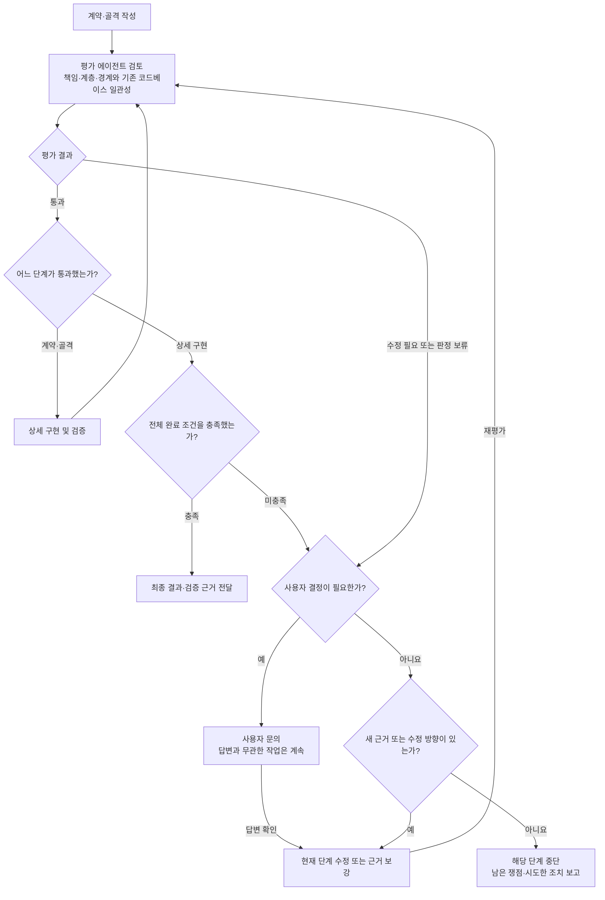

# Rust 구현 자동화 개선 방향

요건에서 위임한 범위 안에서 구현과 평가를 반복하고, 완료 조건을 충족하면 최종 결과를 전달한다.

## 진행 흐름

## 단계별 평가

- **계약·골격** — 평가 에이전트가 정책 판단의 소유자, 계층별 책임, 공개 계약, 의존 방향을 기존 코드베이스의 구조와 비교한다. 통과하면 상세 구현으로 진행한다.
- **상세 구현** — 실제 호출 흐름과 데이터 접근이 골격의 계약을 지키는지 확인한다. 기존 구현을 따르는 경우에도 그 구현이 책임과 경계를 지키는지, 이번 변경이 기존 위반을 확산하는지 평가한다.

## 수정·재평가와 종료

- **평가 결과** — `통과 / 수정 필요 / 판정 보류`와 근거 위치, 영향, 수정 방향을 구현 에이전트에 전달한다.
- **수정 필요** — 구현 에이전트가 지적 사항을 수정한다. 평가 에이전트는 해소 여부와 수정으로 영향받은 경로를 다시 확인한다.
- **통과** — 단계의 완료 조건을 충족하고 진행을 막는 지적이 해소되면 다음 단계로 진행한다. 전체 완료 조건을 충족하면 구현 결과와 검증 근거를 전달하고 종료한다.
- **판정 보류** — 부족한 근거를 확인할 수 있으면 확인한 뒤 재평가한다.
- **반복 중단** — 같은 쟁점이 남아 있고 새 근거나 수정 방향을 찾을 수 없으면 해당 단계에서 멈추고 남은 쟁점과 시도한 조치를 보고한다.
- **사용자 문의** — 계약·범위 변경, 필수 입력·승인처럼 [요건의 사용자 문의 기준](../../../.agents/skills/req-def/SKILL.md#3-사용자-문의-기준)에 해당하는 결정만 문의한다. 답변과 무관한 작업은 이어간다.
